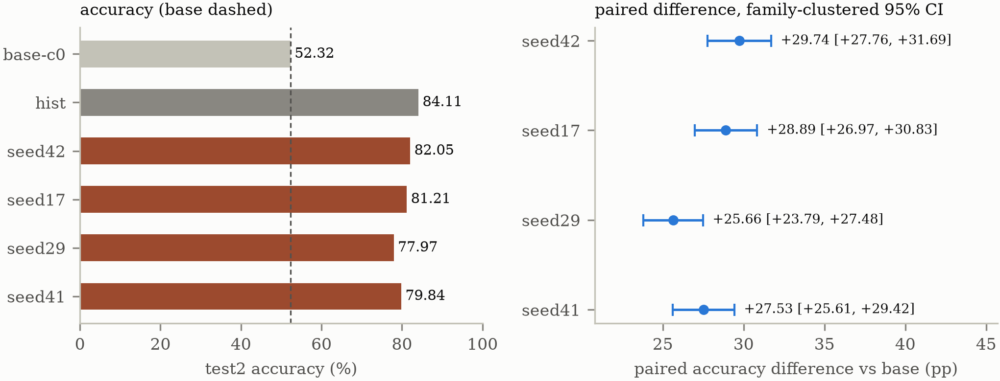
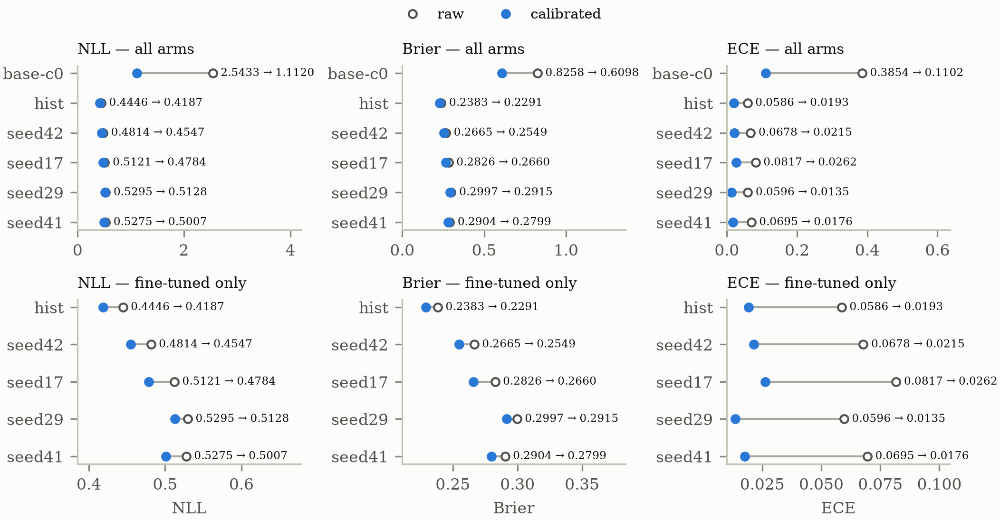
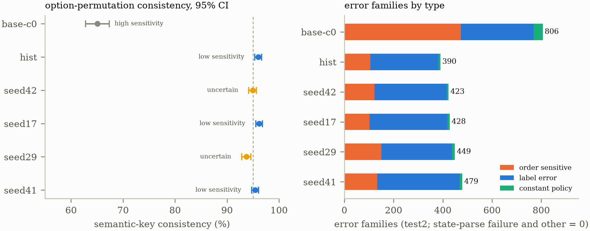

# ReJev 技术报告

**MiniCPM5-2B 上的轻量决策模型 post-training：一项 Jev 风格管线的独立复现**

版本 1.2.2 · [English](technical-report.md)

## 版本记录

- **1.0.0**（2026-09-28）首发。
- **1.0.1**（2026-10-02）补正。
- **1.0.2**（2026-10-04）修订。
- **1.1.0**（2026-10-19）增补多种子、独立终评与概率校准。
- **1.2.0**（2026-10-20）按四个研究问题重组全文；校正上游复用与「聚合成绩一致」的表述。
- **1.2.1**（2026-10-21）补丁：plan/009 记录以脱敏公开副本纳入公开导出集；报告撤下账户状态与 credit 读数。
- **1.2.2**（2026-10-22）修订：摘要与结果叙述对齐论文 v1.2.2 的限定；收窄许可整改与分布外陈述；更正数据出境记录；补公开产物锚点。

---

## 摘要

本报告记录一次**独立复现**：把 Jev 风格的「结构化决策」训练管线移植到 MiniCPM5-2B（2B）。中心读数是：在自建、封存的留出集（1,892 题 / 924 组）上，准确率从 **51.11%**（未微调底座）升到 **80.50%**（+29.39pp，McNemar p=2.94e-96）——该留出集在切分时封存，但此后被用作开发集，因此不是未被触碰的终评——历史生成式协议的约束与无约束两个口径下**有效率均为 100%**。后文依次回答：管线能否迁移、收益能否在重训后保持、候选概率是否更好、顺序敏感性与分布外失败揭示了哪些边界。

这里的 **tev1** 指 Together 公开的 Jev 风格配方——即《How to train your own Jev for $17》的配套仓库。本报告复现的是它的**管线**，**不是** TypeSafe 的 Jev 产品。

**管线能否迁移？** 能：本仓渲染器把 1,300 条上游 prompt 还原得**逐字一致**；本仓以本地权重跑上游公布的那张考卷，**两个分集的聚合成绩与上游公布值一致**——仅比对这两个聚合成绩，**未校验逐题预测**。
这次迁移也留下两次代价：一次**失败的 rank-16→64 探针**（它同时改变了训练切分与评测集；**−23.31pp**，低于底座），以及**许可整改工作**，其测得效应是一个零读数而非损失。原来的 **−2.33pp** 是污染产物；在未污染的 1,892 题留出集上，剔源臂减全量臂为 **+0.63pp**（95% CI [−1.13, +2.37]；未检出差异），而剔源与重切分共变，故不能归因于单一变化。

**收益能否在重训后保持？** 方向上能，但幅度不固定。在冻结的 test2（3,800 题 / 1,659 families；未被任何比较臂用于训练、调参或校准）上，四条仅训练 seed 不同的 LoRA 臂平均准确率 **80.27%**（样本 SD **1.78pp**），相对 base 的同题配对差四臂均为正（**+25.66 到 +29.74pp**）。历史臂与 seed42 的复现检查为 **−2.05pp**（区间 [−3.27,−0.88]），**不可分解**。

**候选概率是否更好、温度校准改善什么？** 五条微调臂的 raw NLL／Brier／ECE 均低于 base；逐臂温度校准使三项进一步下降，且未改变任何预测（**0/3,800**）。校准改善的是**概率质量**，不是分类。

**顺序敏感性与分布外失败揭示了哪些边界？** 语义 key 置换下，微调臂一致率为 **93.71–96.16%**，base 为 **65.08%**；seed42 与 seed29 未达到预锁定低敏感界，标为**不确定**，不写成「低敏感」。在第三方客卷（2,087 题）上，ReJev-2B 的 phishing 召回率塌到 **0**（1,000 条正类全部判为负类），未微调底座在 2,000 题 phishing 子集上的准确率更高（**57.05% vs 50.00%**）：分布内数字**不得外推**。

**本报告不声称**：与官方 Jev 模型等价；复现了 Tev1-4B 评测链之外的内容；可把分布内数字外推到分布外；四 seed 覆盖全部训练随机性；校准提升分类；或置换一致率等于语义机制证据。

阅读提示：本仓的对外发布物是**逐个显式列出的**集合（权威清单以发布工具维护的白名单为准，该工具不随本导出分发；下面的概览非穷举）——概览：`src/`
（`align`/`data`/`train`；`publish/` 下的权重发布工具链已排除，见下）；`docs/plan/` 的 `README` 与 002–006、009；
`docs/experiments/` 的 `README` 与 exp001–004、006–008；本报告（中英两版）与图 3–5；
`tools/` 下四个随发布集分发的脚本（三个 trigger 脚本与 `verify-repro-path.py`）；以及构建与环境文件（`pyproject.toml`、`uv.lock`、
`sources.lock.json` 与仓库根文件，含 `LICENSE`/`NOTICE`/`CITATION.cff`/`REPRODUCING.md`）。

**三处整篇排除**：`exp005` 记录（其第三方权重列含本仓实测数字）、`plan/007` 与 `008`
（权重发布方案）、以及 `src/publish/` 权重发布工具链（它走 HF/魔搭渠道发布、依赖不随
本导出分发的文件——模型卡在内——且其单元测试样例含**字面**的坏凭据样式，脱敏会把
测试改坏，故整目录排除）。

数据、模型权重、原始文本与完整逐题结果文件**均不在仓内**；逐题材料仅为附录 B.5 所述的示例案例记录（case id、预测/金标 key 与标签）。本次增补的 S1 分析记录位于 `docs/experiments/exp008-s1-multiseed/`；其原始训练/评分 JSONL、
adapter 与 checkpoint 在私有 Modal Volume，不随仓库分发。

**S1 分析记录、plan/009 记录与图 3–5 已列入公开导出白名单**（白名单由发布工具维护，该工具不随本导出分发）；承载本次修订的公开集在 GitHub 上以 `v1.2.2` 标签发布（轻量 tag；不创建 GitHub Release 或 DOI）；本报告所有 ReJev 文件链接都钉到该标签，而不是会移动的 `main`；上游链接钉到其自身 commit。

---

## 1. 研究问题与背景

### 1.1 研究问题：小模型的结构化决策

复现一条已发布的训练管线，是区分「配方本身带来了什么」与「它周边的工程带来了什么」的
唯一办法。本报告研究的任务形式是**结构化决策**，而不是自由生成：状态(state) + 问题(question) + 选项(options) → 一个选项。输出被约束为**给定选项集中的一个**，因此「模型会不会说话」不进入评测，
「模型选得对不对」才是全部。这一形式适合在固定任务、固定选项集和可控成本下
考察小模型的专门化：如果任务边界清楚，一个小模型加上任务 SFT 与约束解码，
可能在准确率、延迟和费用上比通用生成模型更合适。这个动机是**待检验的**，
不是本报告的结论；本报告只在一个 2B 底座和一组特定任务上给出读数。

tev1 协议（Together AI, 2026）把公开数据集编译成结构化决策任务，并在一个托管端点后
微调一个 4B 底座；它的公布数字随评测代码一同发布，但完整链路——数据构建、训练、判分——
据所知，并未在更小的规模上被独立重跑过。因此本仓把该管线移植到
MiniCPM5-2B（2B）上，并围绕四个研究问题组织证据：**管线能否迁移**、
**分类收益能否在多次训练中保持**、**候选概率是否可靠、温度校准改善什么**、
**顺序敏感性与分布外失败说明了哪些边界**。第 2 节描述端到端的管线。

凡是能核对的地方，重建都是忠实的：本仓渲染器把 1,300 条上游 prompt 还原得
**逐字一致**，本仓对上游公布的 Tev1-4B 数字的本地读数在**两个分集的聚合成绩上一致**
（§3.1）。得到了什么：在封存留出集上，微调后模型比未微调底座**高出 +29.39pp**，
且无效输出为零（§3.2）。没得到什么：三项负面结果——分布外塌陷、一次失败的容量探针、
一次留出集污染更正（§6.3、§3.4、§3.3）——本仓以与主结果同等的严格度报告它们。

**2026-10-19 增补**加入多种子独立终评与概率校准研究。在新建 test2（3,800 题）上，
四条仅训练 seed 不同的 LoRA 臂为 77.97–82.05%，base 为 52.32%；四臂配对差均为正（C1）。
温度校准改善概率质量但不改变任何 argmax（C2/C3）；语义 key 置换把微调臂与 base 分开，
但两个 seed 保留为「不确定」而非「低敏感」（C5）。第 4–6 章报告这些结果及其边界。

本报告不声称与官方 Jev 模型等价；不声称复现了 Tev1-4B 评测链之外的内容；
也不把分布内数字外推到分布外。本报告也不声称四 seed 覆盖全部训练随机性、
校准提升分类准确率，或置换一致率等于语义机制。

### 1.2 相关工作

本节只定位与本工作直接相关的线路，不做领域综述；每条只写文献实际支持的主张。

本文复现的工作源自 tev1 协议（Together AI, 2026）；本节汇集它所依赖的上游材料
与直接相关的文献。

**任务 SFT 与指令微调。** T5 把各类文本任务统一成 text-to-text 形式并在多任务上
做有监督微调，说明了统一接口下任务 SFT 的可行性（Raffel et al., 2020）。FLAN 与 T0
进一步表明，用自然语言指令或多任务提示做微调可以改善模型在未见任务上的零样本
泛化（Wei et al., 2022; Sanh et al., 2022）。本报告的配方属于这一谱系：它不做
通用对话对齐，只在固定任务上做有监督微调。

**小模型专门化。** MiniCPM 系列用训练策略与数据-模型缩放研究小模型的能力边界，
其 2B 级模型被报告为可接近更大的模型（Hu et al., 2024）。MiniCPM5-2B 是这一家族的
底座；本报告不把「小模型可接近大模型」当作自己的发现，只把底座身份、配方和数据
作为可追溯的实验条件。tev1 则给出了一个公开的 4B 级 Jev 风格配方与上游公布读数
（Together AI, 2026），本报告复现的是它的管线，而不是它的权重或产品。

**约束解码与候选评分。** PICARD 在自回归解码的每一步用增量解析拒绝非法 token，
把输出限制在合法集合内（Scholak et al., 2021）；Outlines 用有限状态机／正则
预计算每个状态的允许 token 集，把约束解码做成逐 token 的 logit 掩码
（Willard & Louf, 2023）。本报告的主评测口径不是生成后解析，而是**候选评分**：
对最后一个 prompt token 的 logits 按本题有效选项 mask 后做 softmax。两种口径
都把输出空间限制在选项集内；候选评分更便于同时导出概率与做温度校准。

**分布偏移。** DomainBed 的工作表明，在分布偏移基准上，经过公平模型选择的
经验风险最小化仍是强基线，很多专门算法并不稳定胜出（Gulrajani & Lopez-Paz, 2021）。
Ovadia 等人在更广的偏移条件下报告，模型的准确率与校准会随偏移强度一起退化，
常规后处理校准不足以恢复（Ovadia et al., 2019）。这为 §6.3 的分布外读数
提供了背景：本报告只报告一张客卷上的实测，不把结论外推到「一切分布外任务」。

**概率校准与选择性预测。** Guo 等人系统比较了多种后处理校准方法，并指出
单参数温度缩放可以在不改变 argmax 的情况下改善概率质量（Guo et al., 2017）；
ECE 与直方图分箱是常用的校准误差度量（Naeini et al., 2015; Guo et al., 2017）。
选择性预测按置信度排序、在覆盖率与错误率之间取舍（Geifman & El-Yaniv, 2017）。
TypeSafe 的 Jev 把输出定义为带概率与置信度的 typed decisions，并声称
「higher confidence means higher accuracy」（TypeSafe AI, 2026）；本报告不检验
该产品，只借用「决策 + 校准」的问题框架，并用候选 softmax 与单标量温度做一个
可复现的最小实现。候选 softmax **不等于**官方 Jev 的校准机制，本报告不作此暗示。

上游 tev1 用确定性代码把五个公开数据集编译成
`state / question / options / answer` 语义层（Together AI, 2026）。本仓**复用其构建器**：
锁定上游 commit 后获取其源码并运行其构建器产出语义层（归属明细见 §2.2.1），
**不把上游构建器代码复制进本仓**；渲染、切分、封存与审计为本仓自写。

- **tev1**（MIT，Together AI, 2026）——任务协议规范、状态归一化与分层切分方法
  源自该项目；本仓**复用其数据构建器**（含 S0 链的 vendored patch，见 §2.3.3），
  但**不把其代码复制进本仓**。
- **MiniCPM5-2B**（Apache-2.0）——底座模型及其官方 LoRA SFT 配方。
- **Tev1-4B-experimental**（Together AI, 2026）——上游模型，其公布数字
  （经托管 API 发布）在 §3.1 作为保真度参照；本工作不分发其权重。

### 1.3 本报告的范围与不声称

- **历史与新增分表。** 历史主结果（1,892 题留出集；exp002 全量 r16）与本轮新增
  test2（3,800 题；四 seed 重训 + 历史 clean-r16 + base-C0）是不同题目、不同模型
  角色的读数，**不合并、不作差值归因**。
- **历史锚点两个口径。** `clean-r16` 在 `holdout1` 单集（n=1,892）上的读数为
  **81.13%**；在 `holdout1 ∪ holdout2` 的 3,694 并集上为 **79.91%**。并集含
  `holdout2`（1,802 题；其中 1,663 个去重 state 全部命中 `rejev-train`，**污染**），
  故并集列的跨臂差距**不可比**；**不得把污染属性挂到 81.13% 上**。
- **不声称**：与官方 Jev 等价；复现 Tev1-4B（只复现评测链）；把分布内外推；
  四 seed 覆盖全部训练随机性；校准提升准确率；置换一致率等于语义机制。
- **不做什么**：不新增 Decision Head 训练；不做 Score／Noul；不换底座；
  不做 4B 配对对照（另见 #123）；不把本轮结果写成对历史结论的追认。

---

---

## 2. 方法与设置

### 2.1 任务形式化

任务是**结构化决策**，不是自由生成：状态(state) + 问题(question) + 选项(options) → 一个选项。与生成式对话模型的区别在于：输出被约束为**给定选项集中的一个**，因此
「模型会不会说话」不进入评测，「模型选得对不对」才是全部。本仓用**状态机约束解码**
（`prefix_allowed_tokens_fn`）实现：候选集是**该题实际选项**对应的字母 token，
而不是固定的 A–X。这样约束解码与上游「按选项表生成 regex」的协议等价。

**历史生成式**评测轮次同时跑**约束**与**无约束**两种口径。两者逐位相同的结论本身就是证据：模型没有依赖约束才选对。S1 的候选评分口径（§2.4.2）测不出无效输出率，两种口径不混读。

本轮新增的候选评分口径（§2.4.2）沿用同一任务形式化，只把读出位置从“生成后的
字母 token”换成“最后一个 prompt token 的有效选项 logits”；两者的选项掩码与
标签映射在同一套数据上核对。

### 2.2 数据

#### 2.2.1 历史数据链

上游 tev1 用确定性代码把五个公开数据集编译成 `state / question / options / answer`
语义层。本仓**复用其构建器**，但不把其代码复制进本仓：锁定上游 commit
`1dde7782382c9f49d627153759b8d1deab426ce0`（MIT）后获取其源码，并直接运行其
`fetch_sources.py` 与 `build_all.py`（后者依次运行 `build_dataset`、`build_v2`、
`build_v21`、`build_new_v1` 四层构建器），产出下表所列语义层。**上游构建器代码不随本仓
分发**（`resources/tev1` 为不入库的只读参考；首次构建由 `resources/tev1` 的克隆完成，
2026-10-11 的隔离重建使用固定提交的干净 `git archive` 作为构建器输入）。

**归属三列**：

- **复用（上游，MIT，commit `1dde7782…`）**——`fetch_sources.py`、`build_all.py` 与四层
  构建器 `build_dataset.py`／`build_v2.py`／`build_v21.py`／`build_new_v1.py`；
  `src/data/render.py` 与 `src/align/v1a_check.py` 中的 SYSTEM 指令与状态归一化**口径**
  亦取自上游对应实现（字符串常量逐字一致，见 `NOTICE` §1）。
- **本仓修改（仅 S0 链）**——`src/data/upstream_patches/0001-rejev-s0.patch`：四层构建器
  的硬编码 SEED 改为环境变量；`build_v2.public_data` 的公开源屏障 `forbidden` 扩展为
  全部历史 statehash 并集，且缺清单时 **fail-closed** 报错；`build_v21` 的 `group_id`
  并入 SEED；`build_new_v1` 的行序 seed 改为环境变量。详见 §2.3.3。
- **本仓自写**——渲染器 `src/data/render.py`（换底座 tokenizer 与 prompt 渲染）与训练专用
  chat template `TRAIN_TEMPLATE`（`src/train/full_train.py`）、两次分层
  切分 `src/data/split_holdout.py` 与 `src/train/split_holdout_v2.py`、历史冻结清单
  `src/data/freeze_history.py`、S0 驱动器 `src/data/build_eval_v2.py`（配额、抽取、切分
  互斥、审计与 RNG 协议）、各校验器（`src/data/verify_*.py`）与选项置换
  `src/data/permute_eval2.py`，以及 `src/train/`、`src/analysis/` 与 `scripts/` 下的
  训练、评测、分析与发布工具。

| 项 | 值 |
|---|---|
| 构建出的训练集 | 37,840 条（43,840 − 6,000 精确重复）/ 16,929,529 tokens |
| 训练集（exp002 全量） | **35,948** 条（37,840 − 1,892 留出） |
| 开发集 | 4,568 条 |
| 封存留出集 | **1,892** 题 / **924** 组 / 9 个 source |
| 切分方式 | 按 `group_id` 整组分层，零泄漏两口径断言 |

**留出集是封存的**：切分脚本写出内容哈希与「同源检测键 / 组键」两个口径的零泄漏断言；
prompt 哈希由渲染模块的 `cross_split_check` 辅助函数覆盖（由其测试执行），标识由重建
校验器检查。此后该集不得用于训练或调参。

五个数据源的许可状态见第 7.2 节——AG News 明确限定非商业用途，SST-5 无已核实的再分发
授权；本仓据此保守处置、不发布其衍生数据。这一处置直接导致了 2.3.1 节的剔源重训（exp006）。

#### 2.2.2 新评测侧三切分（S1）

本轮采用 **A2′**：训练侧复用历史 `train-clean`（30,987 条，SHA `bce0ae24…5b664d`），
只新建评测侧三切分，按 family（`group_id`）整组分配。数据角色与规模如下：

| 角色 | 用途 | 不得用于 | 规模 |
|---|---|---|---:|
| `train-clean` | seed 42/17/29/41 训练 | — | 30,987 |
| dev2 | 实现诊断、吞吐预试验 | 不择优 checkpoint | 500 |
| calibration2 | 拟合单一标量温度 `T_a` | 终评 | 1,500 |
| test2 | 冻结后一次性终评 | 训练、开发、调参、拟合温度 | 3,800（1,659 families） |
| test2-perm | 选项置换检查 | 其他 | 3,800 |

test2 的源配额为：policy_v2 1,326、routing_v2 666、policy 165、
research_taxonomy_v21 424、mnli 554、boolq 332、banking77 333；三切分全部走
官方 held-out 路径，合成源∶公开源 ≈ 68∶32。每个 source 的完整配额与每格最小
family 数见附录 C。

**隔离审计（S0，生成时执行）**：

1. 三切分两两 `statehash` 与 family 交集均为 **0**；与历史 **50,914** 个
   `statehash`、**25,672** 个 family 的交集均为 **0**。
2. 答案位置按 family 内置换预置；表面特征捷径基线的全切分聚合 Δ 最大 2.83pp，
   未触 10pp 门槛；`routing_v2` 的 `longest_description` by-source Δ=13.3pp
   是上游固定选项描述造成的 class prior，已披露。
3. 模板残留与生成器批次风格检查 0 失败；答案位置诊断按 source 报告
   （boolq test2 A 57.2%，z=2.63，p=0.008）。

**披露项（不是拒绝条件）**：test2 约 32% 来自真实公开语料（mnli／boolq／banking77），
**无法排除底座在预训练阶段接触**；合成源约 68% 沿用同一批模板／词表／规则，
**模板同源**；**近重复检查未做**——新数据约 68% 由同一批模板生成，自动近重复
检查会对模板同源产生高误报，无法与“意外近重复”区分；`research_taxonomy_v21`
的 family 标识已改为含 SEED，避免换 SEED 后沿用旧族标识。完整披露清单见
附录 C 与 `009-s0-manifest.json` 的 `disclosures`。

### 2.3 训练配方

#### 2.3.1 历史配方

底座 `MiniCPM5-2B`（Apache-2.0，锁定 revision）。训练输入由 `src/data/render.py` 导出为
`sft` messages；各轮再把它们套进一份**训练专用** chat template（`TRAIN_TEMPLATE`，按
MiniCPM 官方 `docs/finetune/trl.md` 的结构重建），而不是模型自带的那份。本仓不把
Tev1-4B 的 tokenizer 用于准备训练数据。LoRA SFT。各轮**超参**除 rank
一项外逐字相同（exp004 用 r64/α128，见 3.4）：

| 超参 | 值 |
|---|---|
| LoRA | r16 / α32 / dropout 0.05 / all-linear（7 target module） |
| 学习率 | 2e-4 |
| 轮数 / 批 | 1 epoch · batch 2 × grad-accum 2 |
| 调度 | cosine · warmup 0.03 |
| 序列长度 | 2048 |
| 随机种子 | 42 |
| 硬件 | L4 × 1 |

三次训练的差异（**不是单变量对照**——训练集与评测集也各不相同）：

| 轮次 | 训练集 | 步数 | 时长 | train_loss | 成本 |
|---|---:|---:|---:|---:|---:|
| exp002（全量） | 35,948 | 8,987 | 15,111 s | 0.4569 | $5.31 |
| exp004（rank 探针） | 34,146 | 8,537 | 16,855.7 s | **0.8800** | $6.03 |
| exp006（剔源） | 30,987 | 7,747 | 13,774.2 s | 0.4486 | $4.97 |

**成本口径不一，不可直接比较或相加**：exp002 的 $5.31 是 `rejev` app 的**累计**
计费（含该 app 此前全部探错开销）；exp004（训练 $5.18 ＋ 评测 $0.85）与 exp006
（训练 $3.85 ＋ 评测 $1.12）是**逐 app 的 metered 计费**，只含本轮训练与评测。

**exp006 是为许可整改而做的重训**：剔除 AG News（1,354 条）与 SST-5（1,805 条）
共 **3,159 条**（占剔源前同切分训练集 34,146 条的 9.25%），使产出的 adapter 许可链干净、可公开发布。
它同时是一次**消融**：剔源与重新切分两项共变，故其差值不能归因到单一变量。

#### 2.3.2 四 seed 重训与 RNG 协议（S1）

四条臂（seed 42／17／29／41）使用**同一份** `train-clean`、**同一套**配方，
只改训练随机性。历史脚本的时序是“先完成 LoRA 随机初始化（`get_peft_model`），
后创建 `SFTConfig(seed=...)`”；单改 `SFTConfig.seed` 控制不了已发生的初始化。
本轮锁定 **RNG 协议 ①**：在 `get_peft_model` 之前显式 `torch.manual_seed(seed)`，
让 LoRA 初始化也随 seed 变化；`SFTConfig(seed=seed)` 控制数据顺序；不另设
CUDA 种子。这一做法**偏离**历史“不另设 torch/cuda 种子”的纪律，已在报告中声明。
它使四臂之间的差异可归因于 seed；`hist` 与 `seed42` 的差异仍含历史未受控的
初始化与环境项，**不可分解**。

四臂均完成 7,747 步，health PASS、0 failure；墙钟 15,470–15,751 s，
峰值 GPU 6.53–6.62 GB；末 50 步 loss 为 seed42 0.268248、seed17 0.287556、
seed29 0.270453、seed41 0.215001。四臂的 adapter/config SHA、W&B run id
与账单见附录 A 与 exp008 记录。

#### 2.3.3 上游 patch 与生成器身份（S1）

上游生成器锁定为 `togethercomputer/tev1 @ 1dde7782382c9f49d627153759b8d1deab426ce0`（MIT）。
生成器的 SEED 是源码硬编码常量，本轮用 **vendored patch** 修改三类改变数据实例的
SEED（`build_dataset.py`、`build_v2.py`、`build_v21.py`）和一处只改变行序的种子，
并把公开源屏障 `forbidden` 扩展为**全部历史材料的 statehash 并集**；patch 文件与
SHA 随 S0 manifest 入库，`resources/tev1` 只读参考未被修改。新 SEED 为
`rejev-eval2-20261017-1`；冻结的 statehash／family 清单与 patch 指纹见附录 C。

### 2.4 评测协议与统计口径

#### 2.4.1 历史评测口径（原文保留）

- **主口径**：约束解码下的准确率。「有效率」= 输出落在该题实际选项上的比例。
- **区间估计**：主口径用**按 `group_id` 整组重抽的聚类 bootstrap**。本报告两组区间的
  **重抽次数不同**（分别来自两次独立运行），**引用时勿混读**：§3.2 主表为 **2,000 次**
  （分来源表 1,000 次，`seed=20260925`，由 `src/train/jev_compare.py` 输出）；
  §3.3 为 **10,000 次**（见 exp006 记录）。两组区间的卷与子集不同，**以对应章节的
  实验记录为准**。
  同一 group 的多个变体题高度相关，逐题独立性假设不成立——逐题 Wilson 区间仅作参考。
- **配对检验**：逐题 McNemar（两臂同集同题）。

#### 2.4.2 本轮主口径：候选评分

本轮主分类口径锁定为**候选评分（A）**：取最后一个有效 prompt token 的 LM logits，
按**本题实际有效选项** mask，softmax 得到候选分布，取 argmax 作为预测；
raw logits 与概率落盘，供校准与选择性预测复用。字母映射为 A→54 … X→77。
这一口径的 argmax 天然落在有效选项内，**测不出无效输出率**；覆盖率只用于报告
成功评分的比例，**不当作格式能力提升**。历史章节的生成式双口径（约束／无约束）
仍按原协议保留，两者不混读。

#### 2.4.3 指标定义

- **主指标**：同题配对 accuracy 差（每臂 − base-C0，同一 test2 题目集按题配对）。
- **任务**＝test2 记录的 `source` 字段；**类别集**＝该任务的固定语义标签全集
  （`answer_key` 全集），**不随 test2 实际观测到的 gold 集合变化**。
- **语义 macro-F1**：只在任务内的语义类别空间计算，不用 A/B/C… 字母类别；
  某类在真实或预测中缺失时 F1 **记 0**；任务内按类别等权；跨任务按任务等权，
  另附按样本加权的敏感性口径。
- **每类 recall**：同样按任务固定类别集；真实类无样本时记 **NA**，不计入平均。
- **字母口径**：只作选项位置偏好的诊断，不作分类收益的主证据。

#### 2.4.4 区间与不确定性

- 主口径与任务分层区间用**按 `group_id` 整组重抽的 family-clustered bootstrap**，
  10,000 次，seed `20261018`，取 2.5/97.5 百分位；配对差在每次重采样内重算。
- **seed 方差只在 seed 42/17/29/41 四臂之间算**（4 臂＝3 自由度）；在独立运行与正态近似下，
  真实 SD 的 95% 区间约为观测 SD 的 0.57–3.73 倍。
- **训练间差异与样本抽样不确定性分开报**，不合成一个区间。
- `hist` 不进 seed 方差集合；它与 `seed42` 的对比是复现检查。

#### 2.4.5 温度校准

对每个模型臂各自拟合一个标量温度 `T_a`：在 calibration2 上按硬标签 NLL 最小化，
搜索区间 [0.05, 20]（4,001 点，含 T=1）；test2 只应用冻结的 `T_a`，不重新拟合、
不调范围。报告 raw／calibrated 的 NLL、Brier、ECE：ECE 取 **top-label**、
15 等宽箱；Brier 为**多分类求和式**；NLL 按样本平均。标量温度是正标量，
不改变同一样本的 argmax；C3 对每个臂逐题断言校准前后 argmax 不变，
任一 mismatch 即停止并排查。选择性预测按 `p_max` 排序报告覆盖率—准确率曲线，
**只报告，不调回退阈值、不引入大模型回退**。

#### 2.4.6 选项置换

对 test2 按固定规则生成语义 key 置换变体：循环移位
`shift = 1 + (int(sha256(id), 16) mod (n_options − 1))`，保留语义 key 与
description，按新顺序重标 A..；按语义 key 还原后统计一致率、翻转率与
family-clustered 95% 区间。效应量界在 S0 锁定：高敏感＝翻转率点估计 ≥ 0.20；
低敏感＝一致率 ≥ 0.95 且区间下界 ≥ 0.90；否则标为**不确定**。置换一致率只支持
“对选项顺序扰动的敏感性”，**不主张语义机制**——总选某一表面特征在重排后同样
可能保持语义 key 一致；要作语义机制主张须另配内容干预与表面特征对照（本轮不做）。

#### 2.4.7 错误与行为分析

以 family 为归类单位，按固定优先级单标签归类：
**状态解析失败 → 选项顺序敏感 → 恒常策略 → 标签错误 → 其他**。
每类按 `group_id` 升序取前 10 个 error family，每 family 取 id 最小的一行作
代表案例；共同错误（四 seed 全错）与臂间分歧分列计数；`base-C0`／`hist` 独错的
family 入池并单列归属。计数描述，不作显著性主张；机制性断言降级为候选解释。

### 2.5 比较臂与模型身份

| 臂 | 说明 | 产物身份 |
|---|---|---|
| `base-C0` | 未微调 MiniCPM5-2B | `openbmb/MiniCPM5-2B @ 12a3808a…d92e2` |
| `hist` | 历史 clean-r16 adapter，只作复现检查 | adapter `294b07be…b9973e`；config `bf854ccc…` |
| `seed42` | 重训，控制变量臂 | adapter `87a07194…`；config `e82417bf…` |
| `seed17` | 重训 | adapter `bbb1403e…`；config `484093d8…` |
| `seed29` | 重训 | adapter `cb6ac86d…`；config `7906377c…` |
| `seed41` | 重训 | adapter `8227f9ac…`；config `d8839a4d…` |

评分源码为 `eval_candidates.py a4986792…`、`candidate_math.py 0a714e17…`、
`s1_spec.py 734068aa…`；分析源码为 `s1_analysis.py f93424a7…`、
`metrics.py 30d4b575…`。附录 A／D 列出截断 SHA 与 manifest 指针；完整 SHA 在 S1/S0/analysis manifest 或 §7.3（审计链）所述的私有记录中（部分不随本仓分发）。

---

---

## 3. 管线能否迁移

复现的第一个问题是：搬过来的到底是不是同一个东西，以及搬的过程付出了什么。本章先校验测量工具（渲染忠实度与聚合成绩），再给出迁移后的分布内读数与两个历史锚点，最后报告迁移过程中的两次代价——许可整改与一次失败的容量探针——以及一组必须并列而不能归因的历史方向。

### 3.1 渲染忠实度与聚合成绩一致

复现研究的第一问是「我复现的东西是不是同一个东西」。本仓用两条独立证据回答：

1. **渲染忠实度**：用上游模型自带 tokenizer 渲染 1,300 条，与上游发布的
   `instruction/*.jsonl` 的 prompt **逐字一致（1300/1300）**；completion 100% 等于
   `answer + <|im_end|>`。
2. **行为忠实度**：对照 Tev1-4B 的**上游公布值**——**880/1000（88.0%）＋ 300/300
   （100.0%）**（经 Together API 公布）——本仓以本地权重跑本仓复建的那张上游考卷，**两个分集的聚合成绩均未检出偏差**。按 NOTICE §4，这里只声明这一**关系**（「本仓读数与公布值一致」）；
   读数本身**不呈现为本仓结果**。

本地端到端运行与上游公布的**两个分集读数**一致（`main` 的 880/1000 与 `policy_transfer` 的 300/300）；**逐题预测是否相同未作校验**。即便如此，后续所有跨模型比较的**测量工具**，仍是与上游公布数字交叉核对过的。

> 受第三方权重分发许可所限，本仓不发布 Tev1-4B 的逐题结果与其在本仓考卷上的
> 其他派生数字；此处引用上游已公开的数字。

### 3.2 迁移后的收益：历史主结果与两个锚点

| 臂 | 准确率 | 聚类 bootstrap 95% | 有效率 |
|---|---:|---|---:|
| MiniCPM5-2B 底座（未微调） | **51.11%** | [48.53, 53.93] | 100% |
| ReJev-2B（exp002 全量 r16） | **80.50%** | [78.44, 82.54] | 100% |

差值 **+29.39pp**，McNemar χ²≈391.9、精确双侧 **p=2.94e-96**。
约束与无约束两口径**逐位相同**，无效率均为 0%。

底座在二选一与多选混合的卷子上得 51.11%，**高于逐题随机基线 27.66%**（按各题实际
选项数取 1/n 再平均；本卷选项数从 2 到 24 不等）。三个**更强的无技能基线**也都远低于
它——恒定输出最常见字母 **27.91%**、恒定输出最常见语义 key **17.18%**、按选项数取
该组最常见位置 **29.86%**。四个基线的精确口径与可复算实现见
[`src/train/noskill_baseline.py`](../../src/train/noskill_baseline.py)（读同一张封存留出集，
**不带参数跑一次**可复现上面四个数——**前提是两张留出集已在盘上**，见 `REPRODUCING.md`
第 2.4 与 2.5 节；缺文件时脚本会明说缺哪一份，不会静默跳过）。⚠️ 后三个基线是在**同一张留出集上取众数**得出的
**事后描述上界**（拟合与评分用的是同一批标签），只有逐题随机 27.66% 是无拟合的基线。
故**已测的四个基线均低于底座成绩**（其中三个还是事后上界——在同一批标签上取众数也未到；
本报告不据此宣称「任何猜法都过不了」：既未定义「通过」阈值，也没有全策略空间的界）；
微调把它推到 80.50%，且**未测得格式代价**：格式错误在约束解码下按构造就是「不可能」。这是解码协议的性质，不是相对生成式模型的实验优势——未微调底座本身就是生成模型，在本卷的有效率同样是 100%，且本实验没有付出格式代价的生成模型对照臂。

**历史锚点的两个口径**（与上表**分开读**，不合并）：

| 口径 | 模型 | 评测集 | 读数 | 说明 |
|---|---|---|---:|---|
| 单集 | `clean-r16`（已发布；下载链见审计链） | `holdout1`，n=1,892 | **81.13%** | 与 exp002-r16 训练集交集 0；自 exp004 起被充当开发集 |
| 并集 | `clean-r16`（已发布；下载链见审计链） | `holdout1 ∪ holdout2`，n=3,694 | **79.91%** | 并集含 `holdout2`（1,802；1,663 个去重 state 全部命中 `rejev-train`，**污染**）；跨臂差距不可比 |

**不得把污染属性挂到 81.13% 上**；80.50% 是 exp002 全量 r16，81.13% 是已发布的
clean-r16，两者模型不同、训练集不同，不能混读。历史留出集自 exp004 起被开发消费，
其限制继续披露（§7.1）。

### 3.3 许可整改：更正后的读数

exp006 的原始主对照（剔源 vs 全量，3,694 条合计）给出 **−2.33pp**。该数字后来被
判定为**污染产物**：

> `rejev-train`（35,948）与第二张留出集（1,802）的交集是 **1,663 个去重 state 全部命中**
> （题目口径为 **1,802/1,802 全中**）——后者的题目本就是从前者切出来的。
> （1,663 是**去重后的 state 数**、1,802 是**题目数**，两个口径不同：写成「1,663/1,802」
> 会让污染程度看起来比实际轻。）原对照因此含有 1,802 条**模型训练时见过**的题。

在**未被污染**的封存留出集（1,892 题）上重算：

| 口径 | Δ（剔源 − 全量） | 95% CI |
|---|---:|---|
| **全卷（n=1,892）** | **+0.63pp** | [−1.13, +2.37] |
| 保留源（n=1,717） | +1.69pp | [−0.06, +3.47] |
| 受限源（n=175） | −9.71pp | [−17.14, −2.29] |

读法：**在两者都没训练过的题上，未检出差异**（区间含 0）。受限源上的 −9.71pp
与「模型没学过这两类语料」相容，而非能力损失的迹象；但与全卷差值一样，
剔源与切分两项共变，它同样不能归因到单一变量。加权自洽校验：
`(175 × −9.71 + 1,717 × 1.69) / 1,892 = +0.64pp`，与主对照的 **+0.63pp** 相差 0.01pp
——两个值**都落在分源数字四舍五入所允许的区间内**（反解：分源值取任意允许的舍入
组合时，加权均值落在 [+0.631, +0.641]），不是两次计算不一致。

**限制仍在**（见第 7.1 节）：剔源与切分两项共变，+0.63pp 不能归因到单一变化。

### 3.4 容量探针：一次有信息的失败

超参中只把 LoRA rank 从 16 提到 64（lr、调度等逐字相同；**但训练切分与评测集也不同**——训练集 34,146 条、评测集为其新切的 1,802 条），目标是回答「exp003 三方对照实验中定位的弱项是训练不充分还是 2B 容量上限」。exp003 三方对照（2026-09-25）让 base、ReJev-2B 与上游 4B 模型同考一张 1,300 题上游卷；ReJev-2B 86.46%，差距集中在特定任务变体（例如 `routing_v2` 的 `complete_*` 60.5–66.7% vs `multi_missing` 100%），而不是 prompt 长度或选项数（记录见 `docs/experiments/exp003-three-way/README.md`）。

结果：**全面崩坏**。在第二张留出集上，探针 **27.91%** vs 底座 **51.22%**
（−23.31pp，**低于未微调的底座**）；`train_loss` **0.8800**，而 r16 为 0.4569——容量更大的一方最终 train loss 更高。这是对单次运行的观察，不是跨运行排名：各运行的训练数据与评测集不同，rank 也不全同，图 2 的图注明确写着不能把任何两条 run 相互排名；它不能证明探针**连训练集都没拟合上**。严格说「过拟合」指训练与留出 loss 之间的落差，而本仓各轮**都没有划出验证集**（只有 `train_loss` 一项）；此处能排除的只是「训练集拟合更好却更差」这一种解释，**不足以**下「不是过拟合」的定论。9 个 source 全部退化或持平，无例外。

**结论：这是优化失败，不是容量受限。**原问题**未被回答**——探针的真实能力从未被测到，
故不能据此声称「2B 已到容量上限」。最可疑的根因是 α/r 比值虽两臂相同（都等于 2），
但 r64 的可训练参数量是 r16 的 **4 倍**而学习率未随 rank 缩放；这是**假设而非结论**。

一个补充观察：27.91% 与本卷「恒定输出最常见字母」这一平凡基线（27.30%，n=1,802）
仅差 **0.61pp**，提示探针可能已退化为近似恒定输出——这是**观察而非定论**，其确切
失败形态需逐题预测才能判定（逐题结果在 Volume，本轮未分析）。
**注意别与 §3.2 的同形数字混读**：那里的 27.91% 是**基线**（n=1,892 的封存留出集——
exp004 起它同时充当开发集；§2.2.1 表里的「开发集 4,568 条」是 exp002 那一份，两者不是同一个集合），
这里的 27.91% 是 r64 的**实测准确率**（n=1,802），同数不同义。

副产品是本底座上的一次读数：**rank 16 → 64 的这次尝试失败了**。但它**不是**
「配方对 rank 极敏感」的证据——训练切分与评测集也不同，rank 的效应未与它们分离。

### 3.5 与历史方向的一致性及边界（C4／C8）

- **C4（方向）**：test2 上微调臂均高于 base-C0，方向与历史观察（clean-r16 在
  `holdout1` 的 81.13%）一致。但题目不同、模型角色不同，**只作方向并列**，
  不作数值比较或差值归因；不把 81.13% 与 test2 的 84.11%（hist）或 80.27%
  （四 seed 均值）相减。
- **C8（前提）**：test2 对全部评测臂未参与训练；S0 的精确 statehash 与登记
  family 交集检查均为 0。该结论**只覆盖实际检查过的精确 statehash 与登记 family**，
  不外延到语义近重复（未做）或预训练接触（约 32% 公开源，无法排除）。
- **未回答问题**：4B 配对对照暂缓（#123）；test2 无 OOD 臂；未训练 Decision Head、
  未做 Score／Noul；不主张跨任务泛化。阴性/不确定项按预写措辞保留：seed42/29
  置换为 uncertain；30 处单类 recall 下降；C7 差异不可分解；C1 只到方向一致、
  幅度未定。

---

---

## 4. 分类收益能否在多次训练中保持

§3.2 的 80.50% 主结果来自一次训练：`exp002` 全量 r16，用 35,948 条训练、在封存留出集（1,892 题）上评测。本章的重训是另一条臂、另一套数据：它们使用 `clean-r16` 配方，在 `train-clean`（30,987 条）上训练、在 test2（3,800 题）上评测。连同一次对历史 `clean-r16` 臂的复现检查，它们检验的是该配方的稳定性，不是对 80.50% 结果的重跑。

### 4.1 多种子稳定性（C1）

test2 上六臂的主结果如下。`hist` 只作复现检查，**不进 seed 方差集合**；四 seed 的
配对差是同一批题目上对 base-C0 的逐题差，不是与 `hist` 的差。

| 臂 | accuracy | 覆盖率 | 相对 base 的同题配对差 | 95% CI |
|---|---:|---:|---:|---|
| base-C0 | 52.32% | 1.0 | — | — |
| hist | **84.11%** | 1.0 | — | — |
| seed42 | 82.05% | 1.0 | **+29.74pp** | [+27.76, +31.69] |
| seed17 | 81.21% | 1.0 | **+28.89pp** | [+26.97, +30.83] |
| seed29 | 77.97% | 1.0 | **+25.66pp** | [+23.79, +27.48] |
| seed41 | 79.84% | 1.0 | **+27.53pp** | [+25.61, +29.42] |

四 seed 均值 **80.27%**、样本 SD **1.78pp**；四臂配对差均值 **+27.95pp**、SD **1.78pp**。
**正向性成立**（四臂差值均为正；`positive_direction=True`、`zero_arm=False`）。
按 §2.4.4，4 臂只有 3 个自由度，在独立运行与正态近似下，真实 SD 的 95% 区间约为 1.01–6.64pp（观测 SD 的 0.57–3.73 倍）；
本轮**不设 SD 阈值、不设实用改善界**，也不挑最佳 seed。结论只到
「**方向一致、幅度未定**」：四臂都高于 base，但 seed 间差异不小（seed29 比 seed42
低 4.08pp），不能据此宣称“普遍稳定”或“实际重要的改善”。

**图 3.** test2 多种子稳定性。左：base-C0、历史 clean-r16（`hist`，只作复现检查、不进 seed 方差集合）与四条重训 seed 的 accuracy；四条 seed 柱为 seed 方差集合，hist 不在其中；虚线为 base。右：四 seed 相对 base-C0 的同题配对差与 family-clustered 95% 区间（10,000 次重抽）。四臂差值均为正；四 seed 均值 +27.95pp、SD 1.78pp。图不承载“实用重要性”主张；判读见 §4.1。

**任务级一致性**：四 seed 在各任务上的 accuracy、macro-F1 与 present-class macro
recall 方向一致（均不低于 base 的对应任务级指标）；但**单类 recall 层面有 30 处**
（臂×任务×类）低于 base（seed42/17/29/41 分别 7/8/5/10），例如 seed41
`banking77/verify_my_identity` 1.00→0.25、seed42 `routing_v2/route_1` 0.91→0.64、
seed42 `research_taxonomy_v21/science-medicine` 1.00→0.75。**不作逐类一致主张**；
完整逐类 recall 见 `analysis.json` 的 `by_source.*.*.per_class_recall`；`report_assets.py` 可重建表结构。

**成本**：四臂训练合计 **\$17.11830176**；本月 `deployed_apps` 合计
**\$19.70799503**（含 S1 训练与评测；月度 breakdown 未按 app 拆分，S1 专属成本以该合计为**上界**）；本月 metered **\$24.33265711**（含 Volume \$4.62388736 等非 S1 直接项）；无遗留 Modal 任务。

### 4.2 复现检查：`hist` vs `seed42`（C7）

同题 test2 上，`seed42 − hist` = **−2.05pp**，family-clustered 95% CI
**[−3.27, −0.88]**。差异构成为**历史未受控的 LoRA 初始化 ＋ 环境/非确定性**，
两者**不可分解**；它不是 seed 方差，也不单独归因于环境。plan/S0 未见预先声明的
数值范围；差异大小本身是读数。故本报告**不写“复现成功”或“权重级复现”**，
只登记这一复现检查的结果与不可分解限制。

---

## 5. 候选概率校准得更好吗、温度校准改善什么

决策模型的价值不只在选题，也在「它有多确信」。这里「可靠」是**相对**判断——NLL／Brier／ECE 低于 base，且逐臂校准后进一步下降——不是绝对阈值，也不是对某个下游决策的保证。本章报告候选 softmax 的概率质量、单标量温度校准的效果，以及选择性预测曲线的形状；结论只覆盖概率质量，不覆盖分类正确率。

### 5.1 概率质量与校准（C2／C3）

test2 上逐臂的 raw／calibrated 指标如下（`T_a` 在 calibration2 拟合，test2 只应用）：

| 臂 | `T_a` | raw NLL | raw Brier | raw ECE | cal NLL | cal Brier | cal ECE | C3 mismatch |
|---|---:|---:|---:|---:|---:|---:|---:|---:|
| base-C0 | 4.9221 | 2.5433 | 0.8258 | 0.3854 | 1.1120 | 0.6098 | 0.1102 | 0 |
| hist | 1.4806 | 0.4446 | 0.2383 | 0.0586 | 0.4187 | 0.2291 | 0.0193 | 0 |
| seed42 | 1.4673 | 0.4814 | 0.2665 | 0.0678 | 0.4547 | 0.2549 | 0.0215 | 0 |
| seed17 | 1.5579 | 0.5121 | 0.2826 | 0.0817 | 0.4784 | 0.2660 | 0.0262 | 0 |
| seed29 | 1.4198 | 0.5295 | 0.2997 | 0.0596 | 0.5128 | 0.2915 | 0.0135 | 0 |
| seed41 | 1.4455 | 0.5275 | 0.2904 | 0.0695 | 0.5007 | 0.2799 | 0.0176 | 0 |

**C2**：五条微调臂的 raw NLL／Brier／ECE 均低于 base-C0；逐臂校准后三项进一步
下降（臂级聚合；选项数分层内不统一，见附录 B.2）。以 seed42 为例，相对 base 的 raw 差为 NLL −2.0619 [−2.1970, −1.9261]、
Brier −0.5593 [−0.5925, −0.5253]、ECE −0.3176 [−0.3379, −0.2951]；校准后
NLL −2.0887 [−2.2238, −1.9546]、Brier −0.5710 [−0.6033, −0.5383]、
ECE −0.3639 [−0.3814, −0.3377]。各臂的 family-clustered 区间均不含 0。
三指标同向，**不以单一指标下结论**。

**比较基准**：上文的“校准后”相对 base 差值是 `cal(臂) − raw(base)`，不是 `cal(臂) − cal(base)`。五条微调臂的**臂内** `cal − raw` 差值均为负（区间不含 0）；以 seed42 为例，NLL −0.0267 [−0.0367, −0.0172]、Brier −0.0116 [−0.0152, −0.0083]、ECE −0.0463 [−0.0541, −0.0310]。这些臂内差值才是“校准使三项进一步下降”的证据；表中的 `cal` 列是水平值，不是差值。

**C3**：六臂 `T_a` 均未触 [0.05, 20] 边界；逐臂校准前后 argmax mismatch
均为 **0/3,800**。温度是正标量，不改变同题 argmax；校准收益在概率质量，**不在准确率**。对五条微调臂，**校准前后（calibrated − raw）的选择性预测准确率差异**在 ±0.5pp 内；base 在 20% 覆盖下达到 **−8.68pp**。选择性预测曲线总体随覆盖率下降而提高，但并非所有区段都单调（base calibrated 在 coverage 1.0→0.9 时下降 0.80pp）。下表是 seed42 的选择性预测（其余臂见 `analysis.json` 的 `calibration.*.selective`）：

| 覆盖率 | raw accuracy | cal accuracy |
|---:|---:|---:|
| 1.00 | 82.05% | 82.05% |
| 0.90 | 85.94% | 85.85% |
| 0.50 | 96.79% | 96.63% |

选择性曲线**只报告，不据此在 test2 上调回退阈值**；其余臂见 `analysis.json` 的 `calibration.*.selective`。候选 softmax 不等于官方 Jev 的校准机制；本报告不主张复现其校准实现。

**图 4.** test2 上逐臂温度校准前后的概率质量。上排：六个臂全量；下排：五条微调臂，横轴放大（省略 base-C0，以便看清微调臂之间的差异）。空心圆为 raw，实心圆为 calibrated；每对标注 `raw → calibrated`。标量温度不改变任何 argmax（每臂 0/3,800）；收益在 NLL／Brier／ECE，不在 accuracy。判读见 §5.1。

---

## 6. 顺序敏感性与分布外失败说明了哪些边界

前三章都在分布内。本章用选项置换、错误类型与一张第三方客卷，划出这套配方能说什么、不能说什么；其中分布外读数是本报告最重的负面结果。

### 6.1 选项置换检查（C5）

| 臂 | n | 一致率 | 翻转率 | 95% CI | 标签 |
|---|---:|---:|---:|---|---|
| base-C0 | 3,800 | **65.08%** | 34.92% | [62.79, 67.37] | high_sensitivity |
| hist | 3,800 | **96.00%** | 4.00% | [95.32, 96.65] | low_sensitivity |
| seed42 | 3,800 | 94.92% | 5.08% | [94.15, 95.66] | **uncertain** |
| seed17 | 3,800 | 96.16% | 3.84% | [95.51, 96.79] | low_sensitivity |
| seed29 | 3,800 | 93.71% | 6.29% | [92.81, 94.59] | **uncertain** |
| seed41 | 3,800 | 95.42% | 4.58% | [94.73, 96.09] | low_sensitivity |

读法（左列为图 5 左）：微调臂在语义 key 置换后的一致率明显高于 base；但 `low_sensitivity` 只表示
一致率 ≥ 0.95 且区间下界 ≥ 0.90，**不等于“模型读取了语义内容”**。seed42 与
seed29 未达到预锁定的低敏感界，保留 **不确定**，不写成低敏感。位置偏好只作诊断：
base 预测字母偏 C（1,402/3,800），五条微调臂偏 A（1,084–1,153）；字母分布本身
受上游选项置换影响，不能作为分类收益证据。

### 6.2 错误与行为分析（C6）

以 family 为单位、按 §2.4.7 的固定优先级归类：

| 臂 | 错误 family / 总 family | 状态解析失败 | 选项顺序敏感 | 恒常策略 | 标签错误 | 其他 |
|---|---:|---:|---:|---:|---:|---:|
| base-C0 | 806/1,659 | 0 | 473 | 37 | 296 | 0 |
| hist | 390/1,659 | 0 | 105 | 7 | 278 | 0 |
| seed42 | 423/1,659 | 0 | 122 | 7 | 294 | 0 |
| seed17 | 428/1,659 | 0 | 102 | 8 | 318 | 0 |
| seed29 | 449/1,659 | 0 | 150 | 12 | 287 | 0 |
| seed41 | 479/1,659 | 0 | 134 | 10 | 335 | 0 |

四 seed 的**共同错误** family 为 **274**，臂间**分歧**为 **365**；`base` 独错
**291**、`hist` 独错 **11**；`base` 与 `hist` 同错而四 seed 全对 **14**；
四 seed 全错而 `base` 与 `hist` 全对 **1**。错误集中在“标签错误”（句内语义/类别
混淆）与“选项顺序敏感”（同一语义 key 在重排后改变预测）；状态解析失败与
“其他”均为 0；候选评分不可能产生非法选项，因此该类型学下的状态解析失败计数为 0。计数只作描述，不作显著性；
案例按固定规则抽取（每类 `group_id` 升序前 10，每 family 取 id 最小行），
代表案例的 id 与预测/金标 key 见 `analysis.json` 的 `error_analysis.*.cases`（附录 B.5 给出抽取规则），**不贴原始文本**。

**图 5.** 左：语义 key 置换一致率与 family-clustered 95% 区间；横轴自 55% 起，虚线为 0.95 点估计界；标签为预锁定类别（high sensitivity／low sensitivity／uncertain），`uncertain` 不读作低敏感。右：test2 错误 family 的固定类型学计数；状态解析失败与“其他”在每一臂均为 0，柱端数字为错误 family 总数。计数只作描述，不作显著性主张。判读见 §6.1–§6.2。

### 6.3 分布外读数：塌陷

上述一切都在分布内。为回答「这套配方出了训练分布还剩多少」，本仓使用一张**第三方随其评测代码公开的 2,087 题客卷**（`phishing` 2,000 二选一 / `tool_risk` 60 / `ticket_routing` 27）。本仓与该卷在**三个口径上零交集**：题目标识；内容哈希；以及**与 key 结构无关的字段值内容袋**。三个口径均 0 命中（`src/train/verify_exam_overlap.py`，六个语料全 0 命中）。内容类口径因此排除了「同一内容、只换标识」式的同题换名（比对对象为 `state`，不含 `question` / `options`）。

> 内容哈希为整份 `state` 经 NFKC ＋ casefold ＋ 词序列的 SHA256。字段值内容袋对 `state` 的每个叶子值施以同一套归一化后排序取哈希，分**集合与多重集两个口径**：前者忽略重数、更激进，后者保留重数、更精确；换 key 不改，归一化后仍不同的改动必变。

**主口径（phishing，2,000 题，随机基线 50%）**：

| 臂 | 准确率 | recall | FPR | 混淆（TP/FN/FP/TN） |
|---|---:|---:|---:|---|
| MiniCPM5-2B 底座 | **57.05%** | **14.20%** | 0.10% | 142/858/1/999 |
| ReJev-2B r16（exp002） | 50.00% | **0.00%** | 0.00% | 0/1000/0/1000 |
| ReJev-2B 剔源 r16（exp006·**已发布**） | 50.00% | **0.00%** | 0.00% | 0/1000/0/1000 |
| ReJev-2B r64 探针（exp004） | 48.25% | 96.20% | 99.70% | 962/38/997/3 |
| 同门 4B ¹ | 50.65% | 1.30% | 0.00% | 13/987/0/1000 |

> ¹ 这一行的数字是**上游公布值，不是本仓测量**（上游 4B 模型许可未定，本仓不发布对本仓本地跑的上游 4B 权重的实测
> 读数，见 NOTICE §4）。本仓跑过该权重的本地评测，其**三个聚合读数**与上游公布值一致；该行混淆矩阵由这三个公布值在本卷 1000/1000 平衡的结构下唯一导出。这一行证明的是**评分口径
> 一致**——既不是「两边跑的是同一个模型」（见读数 3），也不是对本仓评测链路的校验。

> 另两个子任务（`tool_risk` 60 题、`ticket_routing` 27 题）的逐臂明细见
> [exp007 记录](../experiments/exp007-ood-exam/README.md) 的分 suite 表——它们**不作主口径**，
> 且限制 b 已说明：不得由本表推出「一切分布外任务都塌陷」。该表同门 4B 行的四格**均为上游公布值或由公布值导出，不是本仓测量**；其余臂照列。

四条读数：

1. **50.00% 不是能力值**。r16 与已发布的 clean-r16 把 1,000 条正类**全部**判成负类——
   混淆矩阵一整列是 0。50.00% 只是「恒判一类」在 1000/1000 平衡卷上的取值。
   读这张表时**准确率必须与 recall 一起读**。
2. **底座反而更好**：57.05% vs 50.00%，McNemar **p=2.58e-41**（底座独对 142 题、
   r16 独对 1 题）。**出了分布，微调让模型变差了。**
   但这是**相对**读数：底座 recall 14.20% 本身**远低于**该卷 50% 的逐题随机基线——
   「底座更好」不等于「底座够好」，两者在 phishing 上的正类召回都不可用。
3. **塌陷不是 2B 容量特有的**：同门 4B（见下方口径限定）以同样方式塌陷（recall 1.30%），且把上游随卷附带的逐题产物喂进本仓分析器时，**逐位复现了上游公布值**（50.65% / 1.30% / 0.00%）。⚠️ **口径限定**：上游那一臂跑在 Together 托管端点（`hassan/Qwen3.5-4B-v1-new-…`），**无 config／权重指纹可比**，故本仓只称其为**「同门 4B」**、不称同一 checkpoint。表行引的是**上游公布值**，逐位复现则把**上游**逐题产物喂进**本仓**分析器——两者来源不同；该复现只校验本仓评分口径，**不校验**模型加载与生成链路。详见 [exp007 实现记录](../experiments/exp007-ood-exam/implementation-notes.md) 偏离 7。
4. **对照：官方 Jev 模型未塌陷**（上游公布 recall 42.70%；Together AI, 2026）。这里的「官方 Jev」指上游 tev1 作者在其公开第三方评测中识别为 `typesafe/jev-1.13-20260917`、经 OpenRouter Decisions API 访问的模型；它**不是** §3.1 的上游 4B 模型，也不是本文直接测试的 TypeSafe Jev 产品。同一张卷、同一任务，**塌陷并非任务的固有难度**——存在不塌的解。但该模型与本仓配方在模型与训练上都不同，差异不止配方一项，故这一点不支持「塌陷由配方单独造成」。

**两条附带观察**：

- **在 phishing 子集上，许可整改不改变分布外行为**：r16 与 clean-r16 在 2,000 题上**逐题完全相同**（McNemar 0 vs 0，p=1）。这是限定到子集的陈述：其他子集上读数并不相同（`tool_risk` 85.00% vs 86.67%；全卷 51.32% vs 51.37%），故不外推到整张客卷。
- **r64 朝反方向塌陷**：几乎全判正类（recall 96.20% / FPR 99.70%）。它与 r16 准确率
  无差异（p=0.442）但错误模式近乎互补。

---

## 7. 局限、合规与可复现性

### 7.1 效度与局限

**a. 分布内数字不得外推。** 80.50% 覆盖的是本仓自建并封存的留出集及其同族题目。第 6.3 节给出了
分布外的直接读数：**塌陷**。任何「该模型能处理 X」的声称，若 X 不在本卷分布内，
都缺乏证据。

**b. 塌陷读数的适用范围。** 它只说明该配方在**这一张卷子的二分类子任务**上的行为。
同一模型在同一张卷子的另一套任务（`tool_risk`）上并未塌陷（r16 为 85.00%，
高于底座的 60.00%）。因此**不能**由第 6.3 节推出「ReJev-2B 在一切分布外任务上无效」。

**c. 卷子自建，配比非中立。** 主考卷由本项目自行构造与配比，含主场成分。
第三方客卷（第 6.3 节）是对此的部分对冲，但它的主口径只有二分类一项。

**d. 无分组键的代价。** 客卷每题独立，无 `group_id`，因此没有聚类 bootstrap，
逐题区间**偏乐观**。主考卷有 924 组，这一点上是更好的。

**e. 协议并非严格可比。** 第 6.3 节各行分属不同的解码实现（上游各模型用各自的原生
接口与 regex，本仓用状态机约束）。结论按「同考卷、近似同协议」读。

**f. 预训练接触不可排除。** 客卷的 phishing 材料是公开可下载的合成邮件，
无法排除任一模型在预训练阶段见过。同理，本仓无法证明底座没见过主考卷的任何内容
——只能证明**本仓的切分**没有泄漏。

**g. gold 来自构造规则。** 客卷的标签由其数据集构造规则决定，非独立人工标注。
上游自述「简单 URL 启发式即 91.6%」——该数字是**数据集属性**，不是部署级安全保证。

**h. 配对区间与逐题独立性。** 逐题 McNemar 假定题目独立；同一 group 的变体题高度相关，
故所有逐题 p 值应读作**描述性**，最终判断以聚类区间为准。

**i. 单次运行与 seed 方差。** 历史各轮训练均为单 seed 单次运行；本轮新增四 seed 重训，首次提供了 run-to-run
方差读数；但 4 臂只有 3 个自由度，
在独立运行与正态近似下，真实 SD 的 95% 区间约为观测 SD 的 0.57–3.73 倍，不能把 1.78pp 当作精确的总体 SD。
`hist` 不进 seed 方差集合。

**j. 不存在未受整个配方选择过程影响的最终评测集（历史）；新 test2 的独立性能主张到哪一层。**
历史留出集虽封存，但整套管线（含超参选择）的产生过程参照过它；仅凭现有材料
无法排除这一点。本轮新建的 test2 在 S1 前冻结、未参与训练、调参或温度拟合，
**对本轮四臂与 base-C0 是未触碰的**；但历史配方的超参选择参照过旧留出集，
故新 test2 只能支持“在本轮配方内的同条件比较”，**不能追认为对整个配方选择
过程的独立确认**。旧留出集的消费限制继续保留。

**k. 「未检出差异」不等于「等价」。** 第 3.3 节与任何区间含 0 的比较都只说明
本卷本量级下没有证据，不说明两者相同。

**l. 缺「未微调 4B」对照臂。** 第 6.3 节里同门 4B 按上游自述是「4B 底座 ＋ tev1 配方」，
本轮**没有**把该底座的未微调版本放进同一张卷。因此底座与配方各自的贡献无法分离：
该读数只支持「塌陷不是 2B 容量特有的」，**不支持**「塌陷是配方造成的」。

**m. 任务级宏指标与单类 recall 的差异。** 四 seed 在任务级宏指标上方向一致，
但有 **30 处**（臂×任务×类）单类 recall 低于 base。任务级宏指标可能掩盖少数类的
退化；本报告同时给出逐类读数，不作“每个类都改善”的主张。

**n. 置换只测顺序敏感性。** 语义 key 置换保持内容不变、只改顺序；一致率高只说明预测对顺序扰动不敏感，**不说明模型读取了语义内容**——总选最长选项等表面策略在重排后也可能保持语义 key 一致。要作语义机制主张，须另配内容干预与表面特征对照。

**o. 校准的边界。** 本轮只拟合**每个臂一个全局温度**，不按任务分别拟合；温度是正标量，不改变 argmax，故校准收益在 NLL／Brier／ECE 上，**不能**主张分类准确率提升；选择性预测曲线只报告；校准未显示一致改善选择性预测准确率。候选 softmax 也不等于官方 Jev 的校准机制。

**p. 公开源预训练接触与近重复。** test2 约 32% 来自真实公开语料，无法排除底座
预训练接触；近重复检查未做（模板同源导致高误报）。「零交集」只覆盖实际检查过的
精确 statehash 与登记 family。

**q. 历史锚点两个口径。** 81.13% 是 `holdout1` 单集（n=1,892）；79.91% 是
`holdout1 ∪ holdout2` 的 3,694 并集，并集含被污染的 `holdout2`，跨臂差距不可比。
不得把污染属性挂到 81.13% 上，也不得把 81.13% 与 test2 成绩作数值比较。

**r. 4B 对照暂缓。** 本轮未下载、未训练、未评测 4B；相关限制保留（#123）。

---

### 7.2 许可与合规

项目的发布策略按**数据源的许可状态**逐项判定，而不是按「是否公开可得」：

| 数据源 | 许可状态 | 训练（内部研究） | 发布衍生数据 |
|---|---|---|---|
| MultiNLI | 混合（主体走 OANC EULA，非 CC） | ✅ | 按条款 |
| BoolQ | CC BY-SA 3.0 | ✅ | 按条款（ShareAlike 口径另判） |
| Banking77 | CC BY 4.0 | ✅ | 按条款（署名） |
| **AG News** | 卡片限定「研究及其他非商业用途」 | ✅ | ❌ |
| **SST-5** | **已核实**：无许可元数据——溯源链四层（Stanford 页面 / CS287·HW1 仓 / AcademiaSinicaNLPLab 仓 / SetFit·sst5 卡片）均无声明。**未核实**：论文全文与作品级授权链未核清（Stanford 页面已读，无条款）。**处置**：把「无声明」按「未授权」保守对待，不随衍生数据发布 | ✅ | ❌ |

**判定**：五源均用于**内部、非商业研究训练**。AG News 的卡片允许研究及其他非商业用途；SST-5 的溯源链四层均无许可声明，本仓把「无声明」按**未授权再分发**处理，而不把它读成禁止内部研究使用。**本仓不发布包含这两个受限源的衍生数据**（AG News 明确限定非商业用途；SST-5 无已核实的再分发授权）。因此公开发布的 adapter 来自剔源重训（30,987 条，剔除 3,159 条）。

**合成部分**：上游用纯确定性代码生成合成样本（零外部数据输入、零 API 调用、
零模型生成），且**从未对其声明许可**。本仓是生成方而非接收方。

**Tev1-4B 权重**：其许可状态未定，故本仓**不发布**该权重的任何副本或逐题结果，
仅在本仓内部作研究对照；第 3.1、6.3 节只引用上游已公开的数字。

**S1 新评测侧**：合成源（policy／policy_v2／routing_v2／research_taxonomy_v21）
由 vendored 上游生成器（在临时副本上打过 patch 的上游构建器，归属见 §2.2.1）
确定性生成；公开源（mnli／boolq／banking77）沿用其原始
许可，**不发布完整**衍生逐题数据；随包逐题材料的范围见上文的公开发布范围注。**混合训练数据保留本地**，不提交、不上传；本轮报告
只发布聚合指标、案例 id 与预测/金标 key，不发布原始文本。上游 patch 只修改
SEED 与 `forbidden` 屏障，随仓库以 MIT 兼容方式登记；`resources/tev1` 只读参考
未被修改。

**未核验项（如实登记）**：MultiNLI 的一个子项许可未能核实；SST-5 的论文全文与
作品级授权链未核清。发布物只声称「按上述判定处理」，不声称已穷尽核验。

---

### 7.3 可复现性审计链

结论关联到精确的代码、权重、数据与环境版本，以其被记录的程度为限——缺口列于下文。

**代码**：exp001（`326ff04`）与 exp002（`9a40878`）的训练 commit 记在各自实验记录内；
exp003 / exp004 / exp006 / exp007 的**未记录**（见下「已知缺口」）。模型卡的构建与推送脚本
在本仓 `src/publish/`（权重发布工具链，不随公开发布集分发——见上文范围注）。

**历史模型与数据（内容指纹）**：

| 物件 | 标识 |
|---|---|
| 底座 | `openbmb/MiniCPM5-2B` @ `12a3808a956f869c767195e9266b59c4d21d92e2` |
| 已发布 adapter（clean-r16） | SHA256 `294b07be…b9973e`（纯 LoRA adapter，非合并权重，7 target module）；[HuggingFace `joe-q/rejev-minicpm5-2b-choice`](https://huggingface.co/joe-q/rejev-minicpm5-2b-choice)、[ModelScope `joeqrq/rejev-minicpm5-2b-choice`](https://modelscope.cn/models/joeqrq/rejev-minicpm5-2b-choice) |
| exp002 adapter（未发布，对照臂） | SHA256 `c82857d2…` |
| 训练集（clean，30,987 条） | SHA256 `bce0ae24…5b664d` |
| 训练集（全量，35,948 条，渲染件） | SHA256 `59586b44…bc1c09`（渲染件 `train-full.jsonl`；records 级 SHA256 `aa1e490a…880b85` 见 [`docs/reproducibility/history-hashes.json`](../reproducibility/history-hashes.json)） |
| 评测集（3,694 条） | SHA256 `8423a838…720f96`（逐臂断言） |
| 封存留出集（1,892 题） | SHA256 `2601d649…9063` |
| 上游构建产物 | 与上游 dataset-manifest **逐位一致** |

**约定**：表中 SHA256 为**截断表示**（首 8 位 … 末 6 位），用于人眼比对。完整值
**并非都在本仓内**：训练集、评测集、封存留出集的完整哈希在本仓代码（`clean_train.py` / `jev_compare.py` 等）中可查，全量训练集（渲染件）的完整哈希不发布（只给上表的截断值；records 级哈希 aa1e490a…880b85 见 [`docs/reproducibility/history-hashes.json`](../reproducibility/history-hashes.json)；**已发布 adapter 的完整哈希在不随本发布集分发的权重发布
工具链中，本集只发布上表的截断表示**；**exp002 adapter
（未发布对照臂）只有截断前缀，全量哈希在 Modal Volume 的 manifest 里、不随本仓发布**。
底座 revision 给出全 40 位，因它是外部标识、需可原样引用。

**S1 新链（2026-10-19 增补）**：

| 物件 | 标识 |
|---|---|
| 上游生成器 | `togethercomputer/tev1 @ 1dde7782382c9f49d627153759b8d1deab426ce0` |
| 上游 patch | `src/data/upstream_patches/0001-rejev-s0.patch`；指纹见 S0 manifest |
| 新 SEED | `rejev-eval2-20261017-1` |
| 历史 statehash 清单 | 50,914 条；`src/data/frozen/historical-statehashes.txt` |
| 历史 family 清单 | 25,672 条；`src/data/frozen/historical-families.tsv` |
| S0 manifest | `docs/plan/009-s0-manifest.json` source-of-record SHA256 `5c33d48b…44f418`；public copy `504a7fcd…64b17` |
| S1 manifest | `docs/plan/009-s1-manifest.json` source-of-record SHA256 `41f1a53e…87f6e3`；public copy `3787d14f…db23b7` |
| 四臂 adapter/config | 见 §2.5 与 exp008 记录 |
| 评分源码 | `eval_candidates.py a4986792…`、`candidate_math.py 0a714e17…`、`s1_spec.py 734068aa…` |
| 分析源码 | `s1_analysis.py f93424a7…`、`metrics.py 30d4b575…` |
| 分析产物 | `analysis.json` `695e9054…a84ff`、`analysis.md` `97e4aba4…e28f6`、`analysis-manifest.json` source-of-record `f5dee8f5…8ef18`、public copy `18d724cc…b52e4` |
| 24 个评分输入 SHA | 见 `analysis-manifest.json` 的 `inputs`；`load_all_validated` 实跑 57,600 条记录通过 |

**评测器自带自检**：本仓的 OOD 判读脚本把上游随卷附带的逐题产物喂进自己，
必须**逐位复现**上游公布数字，否则拒绝产出。这条自检在本轮实际拦下过一次
实现错误（正类判定用了字母标签而非语义键——正类落在哪个字母由选项顺序决定，
按标签判会在选项顺序不同的题目上**静默**判错）。

**已知缺口（如实登记）**：

- 一次训练的 manifest 中 `code_commit` 写的是占位符而非真实提交哈希，
  该轮的代码版本**无法由 manifest 自证**。
- **exp003 / exp004 / exp006 / exp007 四轮的代码 commit 未记入实验记录**（exp001／exp002
  有）。这四轮的读数因此**不能由某一个 commit 复现**；可复现的是脚本本身与配置（已在
  各记录中列明），不是当时的代码快照。
- 端到端复现链**未在干净环境重跑**（需 HF token 与 GPU 额度）。
  复现文档中每一步都标注了验证状态，不要把「文档写了」当作「已被验证」。
- **S1 的 `analysis-manifest.json.created` 字段为分析源码硬编码的 `2026-10-18`，
  实际运行日为 2026-10-19**；未修改冻结的分析源码，以上述实际运行时间与本目录 SHA 为准。
- S1 的原始训练/评分 JSONL、adapter 与 checkpoint 在私有 Modal Volume，
  **不随仓库分发**；W&B run id 与账单为转录，离线不可复核。
- S1 manifest 的 `notes[0]` 是 seed42 启动前的基础结构快照；`runs[]` 已登记四臂完成。
  勿以该句判断当前状态（详见 exp008 记录 §8）。

---

### 7.4 复现指引

完整的操作步骤、验证分级与校验命令见 [REPRODUCING.md](https://github.com/Joe-rq/ReJev/blob/v1.2.2/REPRODUCING.md)
（随本仓发布）。三条要点：

1. **`uv sync --group align`**——数据链与对齐检查的依赖不在 uv 默认组里，
   不加这个参数会得到空环境。
2. **训练与全量评测用 `deploy` + `spawn`，不要用 `modal run` 直接跑**。
   后者把本地进程绑在远程任务上，本地被终止时会把 cancellation 送到远程
   **杀掉正在跑的任务**。
3. **每臂必须核对封存集指纹**——行数断言挡不住「同样行数的另一份文件」。

**S1 新增入口**（以 manifest 与 exp008 记录为准）：

- S0 重建与审计：`src/data/build_eval_v2.py`、`src/data/verify_eval2.py`、
  `src/data/verify_patch_barrier.py`、`src/data/verify_rebuild_evidence.py`；
  先读 `docs/plan/009-s0-manifest.json` 的冻结值。
- 训练：`src/train/multiseed_train.py`（`modal deploy` + `.spawn()`）；
  四个 seed 与 RNG 协议 ① 写入 S1 manifest。
- 评分：`src/train/eval_candidates.py`（六个臂 × dev2／calibration2／test2／test2-perm）。
- 分析：`uv run python src/analysis/s1_analysis.py --scores-dir <scores> --out <out>`；
  报告表：`uv run python src/analysis/report_assets.py --analysis <analysis.json> --out <dir>`。
- 图 3–5：`uv run --group figures python src/analysis/s1_figures.py --analysis <analysis.json> --out docs/paper/figures --force`（需要 `figures` 依赖组；交付目录需 `--force`）。
- 论文链：论文构建与一致性核对两个脚本（不随本导出分发）。

**S0 冻结清单缺口（如实登记）**：重建 S0 需要 `src/data/frozen/historical-statehashes.txt`（50,914 条）与 `src/data/frozen/historical-families.tsv`（25,672 条）。这两份清单**不在**公开导出中：它们是内部隔离屏障，公开其哈希会提供成员推断入口，并暴露由两个受限源派生的哈希（§7.2）。清单可用 `uv run python src/data/freeze_history.py` 从历史 records（同样不随发布集分发）再生；再生结果必须分别匹配 SHA256 `432eb8ef…8cb622`（statehash）与 `956d5b78…b45164`（family），`freeze_history.py --check` 可在不漂移时校验现有清单。由于清单及其输入都在公开集之外，**仅凭公开集无法重建 S0**；这是如实登记的复现缺口，不声称端到端可复现。

**不可复算部分**：Modal Volume 中的原始训练/评分 JSONL、adapter 与 checkpoint；W&B 运行记录；账单为 `modal billing summary --json` 的转录。报告中的聚合数字可由 `analysis.json` 复算，但**完整**逐题记录不在仓库内；仓内唯一的逐题材料是附录 B.5 所述的示例案例记录。

---

### 7.5 如实记录

本报告与它所述的工作**不是一路顺风的**。以下记录不修，因为它们与结果同等有信息量：

- **一次数据出境**：某轮评审中，评审提示指向 `data/rejev/records/`，一条评审谱系在只读沙箱内读取了考卷题面与题号／答案标识，这些内容到达了 **OpenAI**。这是当时授权范围之外的第二个目的地（当时的授权覆盖的是把 1,892 题封存留出集发送至 TypeSafe API 做对照评测）；密钥、训练数据与权重均未流出。该项已按所有者判定「记录即止」处置，不构成对同类行为的预先授权。
- **三处「假声明」**：在评审中发现过三次「声称改了而实际没改」，
  均记录在案并已修。它们促成了本项目「判据不靠人工声明、靠机械校验」的做法
  ——例如导出器的每条脱敏规则都要求**至少命中一次**，写「已改」而实际没改会
  变成一条失败而不是一句声明。
- **一次评审发现被用于修正结论**：某轮评审从一处算术异常（模型卡称训练用了 35,948 条，
  而 30,987 + 3,159 = 34,146，且 34,146 + 1,802 = 35,948）挖出了第 3.3 节的留出集污染。
  这条链路的教训是：**把每个数字与其来源放在一起，异常会自己浮出来**。
- **一处索引缺口（已补齐）**：方案索引曾缺一行（既有缺口，明确列为「不顺手修」）；本次发布前已补上。
- **两次口径不一致**：早期实验记录保留了更正前的数字（第 3.3 节所述的留出集污染更正），
  本报告统一采用更正后口径；各实验记录内的原文未改写，差异已登记。
- **S1 的 seed41 与单类下降**：seed41 的末 50 步 loss 最低（0.2150），但 test2
  accuracy 为四 seed 第三（79.84%）；四 seed 共 30 处单类 recall 低于 base
  （7/8/5/10）。四臂均完整执行，按预定纪律**不重训、不剔除**，作为研究结果保留。
- **S1 的不确定项**：seed42／seed29 的置换一致率未达预锁定的低敏感界，标为
  **uncertain**；C7 的 `seed42−hist` 差异含未受控初始化与环境项，**不可分解**；
  不写「复现成功」。
- **S1 的 provenance 小缺陷**：`analysis-manifest.json.created` 硬编码为
  `2026-10-18`，实际运行日为 `2026-10-19`；未改冻结分析源码，已在 §7.3（已知缺口）与
  exp008 记录中登记。

---

---

## 8. 结论

**已经获得的证据。** 这套管线可以迁移到 2B 的本地权重上，并且迁移后的测量工具与上游对齐：渲染可逐字还原，两个分集的聚合成绩与上游公布值一致——但逐题预测没有比对，所以这证明的是**评分口径一致**，不是「跑的是同一个模型」。在这个被校准过的工具下，迁移本身成立，但两组证据不是一次复现：`exp002` 全量 r16 用 35,948 条训练、在封存留出集（1,892 题）上评测，给出 +29.39pp 的分布内收益，且无效输出为零；另一组是 `clean-r16` 配方的四条独立 seed，在 `train-clean`（30,987 条）上训练、在 test2（3,800 题）上评测，配对差保持正向（+25.66 到 +29.74pp；均值 +27.95pp，SD 1.78pp）。两者模型、训练集与评测集都不同，seed 结果不是对 80.50% 结果的重跑。

**收益不是无损的。** 最好的与最差的 seed 相差 4.08pp；与历史臂的复现检查给出 −2.05pp 的差异，且该差异含未受控的初始化与环境项，不可分解。因此可以说「配方在这个底座上稳定优于其底座」，不能说「每次训练都能复刻同一个数」。同样地，容量上限**没有被回答**——r64 探针是优化失败，不是容量受限。

**概率能给什么、不能给什么。** 候选 softmax 的排序信息是有用的：温度校准在不改变任何 argmax 的前提下改善了 NLL／Brier／ECE，选择性预测曲线整体随覆盖率下降而上升。但校准改善的是**概率质量**，不是**分类正确率**；把校准后的置信度读成「更准的模型」是误读。

**边界在哪里。** 顺序敏感性与分布外读数是这份报告最重的负面结果。微调臂对选项顺序的敏感性显著低于 base，但两个 seed 仍未达到预锁定的「低敏感」界；而在第三方客卷上，微调把 phishing 正类召回压到了 0——比未微调底座更差。这意味着本报告的正面结论都只在**分布内、固定任务形式、固定选项集**的条件下成立；一旦离开这个条件，观察到的是塌陷而非温和退化。同一张卷的其他子任务没有塌陷，所以这也不是「该配方在一切分布外任务上无效」。

**没有获得的能力。** 容量上限未被回答；「与官方 Jev 等价」未被检验；「置换一致率等于语义机制」未被证明；四 seed 不覆盖全部训练随机性；分布外的失败形态只在一张卷、一个二分类子任务上被观测到。

**适用范围。** 以上结论对应 MiniCPM5-2B、锁定 commit 的开源与合成语料、以及本报告列出的模板与评测协议。它们不自动外推到其他底座、其他任务形式或其他分布，也不构成对「小模型 + 任务 SFT + 约束解码」这一路线的普遍判断——本报告只给出了一个 2B 底座与一组特定任务上的读数。

---

## 引用与致谢

- **[tev1](https://github.com/togethercomputer/tev1/tree/1dde7782382c9f49d627153759b8d1deab426ce0)**（MIT）——任务协议规范、状态归一化
  与分层切分方法源自该项目。本仓**复用其数据构建器**，但不把其代码复制进本仓
  （归属三列见 §2.2.1）。
- **MiniCPM5-2B**（Apache-2.0）——底座模型及其官方 LoRA SFT 配方。
- **TypeSafe AI, “Introducing System One Models & Jev”**（2026-09-15，
  https://typesafe.ai/blog/introducing-system-one-models-and-jev）——Jev 的
  typed probabilistic decisions 与 calibrated probabilities 口径；本报告不检验该产品。
- **Together AI, “How to train your own Jev for $17”**（2026，https://www.together.ai/blog/how-to-train-your-own-jev）与 tev1 仓库——上游配方、数据规模与公布读数。
- **Together AI, “tev1: Public Third-Party Evaluation”**（2026，https://github.com/togethercomputer/tev1/blob/1dde7782382c9f49d627153759b8d1deab426ce0/evaluation/public-third-party/README.md）——识别 Jev 模型为 `typesafe/jev-1.13-20260917`（经 OpenRouter Decisions API）；公布 phishing recall 42.7%。
- Raffel, C. et al. (2020). *Exploring the Limits of Transfer Learning with a Unified
  Text-to-Text Transformer.* JMLR 21(140):1–67. arXiv:1910.10683.
- Wei, J. et al. (2022). *Finetuned Language Models Are Zero-Shot Learners.* ICLR 2022.
  arXiv:2109.01652.
- Sanh, V. et al. (2022). *Multitask Prompted Training Enables Zero-Shot Task
  Generalization.* ICLR 2022. arXiv:2110.08207.
- Hu, S. et al. (2024). *MiniCPM: Unveiling the Potential of Small Language Models
  with Scalable Training Strategies.* arXiv:2404.06395.
- Scholak, T., Schucher, N., & Bahdanau, D. (2021). *PICARD: Parsing Incrementally for
  Constrained Auto-Regressive Decoding from Language Models.* EMNLP 2021,
  pp. 9895–9901. DOI 10.18653/v1/2021.emnlp-main.779; arXiv:2109.05093.
- Willard, B. T., & Louf, R. (2023). *Efficient Guided Generation for Large Language
  Models.* arXiv:2307.09702.
- Gulrajani, I., & Lopez-Paz, D. (2021). *In Search of Lost Domain Generalization.*
  ICLR 2021. arXiv:2007.01434.
- Guo, C., Pleiss, G., Sun, Y., & Weinberger, K. Q. (2017). *On Calibration of Modern
  Neural Networks.* ICML 2017, PMLR 70:1321–1330. arXiv:1706.04599.
- Naeini, M. P., Cooper, G., & Hauskrecht, M. (2015). *Obtaining Well Calibrated
  Probabilities Using Bayesian Binning.* AAAI 2015, pp. 2901–2907.
  DOI 10.1609/aaai.v29i1.9602.
- Ovadia, Y. et al. (2019). *Can You Trust Your Model's Uncertainty? Evaluating
  Predictive Uncertainty Under Dataset Shift.* NeurIPS 2019. arXiv:1906.02530.
- Geifman, Y., & El-Yaniv, R. (2017). *Selective Classification for Deep Neural
  Networks.* NeurIPS 2017, pp. 4878–4887. arXiv:1705.08500.
- 五个公开数据集的作者与维护者；许可状态见第 7.2 节。
- 数据来源逐项锁定见 `sources.lock.json`，第三方声明见 [NOTICE](https://github.com/Joe-rq/ReJev/blob/v1.2.2/NOTICE)。

**本仓不含数据、模型权重、原始文本或完整逐题结果文件（仅为附录 B.5 所述的示例案例记录（case id、预测/金标 key 与标签）），也不分发任何 Tev1-4B 资产。**

---

---

## 附录 A · 完整配置与身份

### A.1 训练配置

| 项 | 值 |
|---|---|
| 底座 | `openbmb/MiniCPM5-2B @ 12a3808a956f869c767195e9266b59c4d21d92e2` |
| LoRA | r16 / α32 / dropout 0.05 / all-linear（7 target module） |
| 学习率 | 2e-4 |
| 轮数 / 批 | 1 epoch · batch 2 × grad-accum 2 |
| 调度 | cosine · warmup 0.03 |
| 序列长度 | 2048 |
| 精度 | bf16；`assistant_only_loss`；`packing=False` |
| 硬件 | L4 × 1；单次训练 ≤ 6 小时 |
| 平台 | Modal `deploy` + `.spawn()` |
| RNG 协议 | ①：`get_peft_model` 前 `torch.manual_seed(seed)`；`SFTConfig(seed=seed)`；不另设 cuda 种子 |
| seed | 42 / 17 / 29 / 41 |

### A.2 四臂运行清单

| seed | steps | wall | 峰值 GPU | 末 50 步 loss | cumulative | adapter SHA256 | config SHA256 | W&B | metered |
|---:|---:|---:|---:|---:|---:|---|---|---|---:|
| 17 | 7,747 | 15,740.6s | 6.53GB | 0.287556 | 0.463810 | `bbb1403e…` | `484093d8…` | `ecd5pw27` | $4.30145456 |
| 29 | 7,747 | 15,751.0s | 6.60GB | 0.270453 | 0.470156 | `cb6ac86d…` | `7906377c…` | `d8cku50z` | $4.31092469 |
| 41 | 7,747 | 15,470.1s | 6.61GB | 0.215001 | 0.490325 | `8227f9ac…` | `d8839a4d…` | `tcyn90l0` | $4.23096959 |
| 42 | 7,747 | 15,646.2s | 6.62GB | 0.268248 | 0.454274 | `87a07194…` | `e82417bf…` | `yfi4gjnp` | $4.27495292 |

### A.3 评分、校准与错误分析协议

- 评分：`s1-candidate-v2`；最后一个 prompt token 的 logits → 有效选项 mask →
  softmax；A→54…X→77；raw logits/probs 落盘。
- 校准：逐臂 `T_a`，calibration2 拟合，logits 稳定 log-softmax；网格 [0.05,20]，
  4,001 点；test2 只应用。
- 区间：family-clustered bootstrap 10,000 次，seed `20261018`，2.5/97.5 百分位。
- 置换：`shift = 1 + (int(sha256(id),16) mod (n_options-1))`；效应量界见 §2.4.6。
- 错误：family 单位；优先级“状态解析失败 → 选项顺序敏感 → 恒常策略 → 标签错误 → 其他”；
  每类按 `group_id` 升序前 10，每 family 取 id 最小行。

## 附录 B · 分任务与分层表

### B.1 六臂 × 七任务（test2）

完整表见 `analysis.json` 的 `by_source` 字段与 exp008 `analysis.md`。下表给出
四 seed 与 base／hist 的关键读数（accuracy；完整 family-clustered 95% CI 见 `analysis.json` 的 `by_source`）：

| 任务 | n | base-C0 | hist | seed42 | seed17 | seed29 | seed41 |
|---|---:|---:|---:|---:|---:|---:|---:|
| banking77 | 333 | 73.87% | 92.49% | 90.99% | 91.59% | 91.89% | 91.59% |
| boolq | 332 | 77.11% | 86.45% | 84.04% | 88.25% | 86.14% | 84.94% |
| mnli | 554 | 55.78% | 85.74% | 85.74% | 84.30% | 86.10% | 83.94% |
| policy | 165 | 50.91% | 100.00% | 100.00% | 100.00% | 99.39% | 100.00% |
| policy_v2 | 1,326 | 38.61% | 81.45% | 77.38% | 74.13% | 69.83% | 71.57% |
| research_taxonomy_v21 | 424 | 96.70% | 99.06% | 99.06% | 100.00% | 99.76% | 98.11% |
| routing_v2 | 666 | 25.68% | 69.22% | 67.57% | 67.42% | 57.21% | 67.87% |

完整 CI、macro-F1、macro recall、混淆矩阵见 `analysis.json` 的 `by_source` 字段；
per-source 配对差见 `seed_analysis.per_seed.<seed>.by_source_paired_diff.<source>`；
`report_assets.py` 可重建表结构。

任务等权与按样本加权的 macro-F1 聚合见 `analysis.json` 的 `by_source.<arm>._task_equal_macro_f1` 与 `by_source.<arm>._sample_weighted_macro_f1`；两套口径下四 seed 均高于 base-C0（两者互换 seed42 与 seed17 的次序）。

### B.2 选项数分层（seed42）

| 选项数 | n | raw acc | raw ECE | cal acc | cal ECE |
|---:|---:|---:|---:|---:|---:|
| 2 | 332 | 84.04% | 0.1141 | 84.04% | 0.0744 |
| 3 | 2,045 | 81.47% | 0.0795 | 81.47% | 0.0312 |
| 4 | 122 | 93.44% | 0.0441 | 93.44% | 0.0644 |
| 5 | 666 | 67.57% | 0.0724 | 67.57% | 0.0412 |
| 6 | 116 | 87.93% | 0.0777 | 87.93% | 0.0723 |
| 8 | 201 | 95.52% | 0.0332 | 95.52% | 0.0311 |
| 12 | 106 | 100.00% | 0.0030 | 100.00% | 0.0087 |
| 24 | 212 | 98.58% | 0.0129 | 98.58% | 0.0106 |

六臂的完整选项数分层见 `analysis.json` 的 `calibration.*.by_option_count`。

这是臂级陈述：在选项数分层内符号并不一致。seed42 的 4 选项与 12 选项层，校准后 NLL 与 ECE 略高于 raw（NLL 0.1997→0.2013、0.0034→0.0094；ECE 0.0441→0.0644、0.0030→0.0087）。

### B.3 选择性预测（seed42）

| 覆盖率 | raw accuracy | cal accuracy |
|---:|---:|---:|
| 1.00 | 82.05% | 82.05% |
| 0.90 | 85.94% | 85.85% |
| 0.50 | 96.79% | 96.63% |

其余覆盖率（0.05/0.10/0.20/0.30/0.70）与其余五臂见 `analysis.json` 的
`calibration.*.selective`。

### B.4 单类 recall 下降明细（30 处）

完整逐类表由 `src/analysis/report_assets.py` 从 `analysis.json` 的
`by_source.*.*.per_class_recall` 重建；本报告在 §4.1 给出计数与代表例，
不重复列出 30 行。

### B.5 案例抽取

每类按 `group_id` 升序取前 10 个 error family，每 family 取 id 最小的一行；
代表案例的 `group_id`、`id`、`pred_key`、`gold_key`、`pred_label`、`gold_label`
见 `analysis.json` 的 `error_analysis.*.cases`。不贴原始 state／question 文本。

## 附录 C · 数据构建、隔离审计与披露

### C.1 上游 patch 与冻结清单

- 上游 `togethercomputer/tev1 @ 1dde7782…`（MIT）。
- vendored patch：`src/data/upstream_patches/0001-rejev-s0.patch`；修改
  `build_dataset.py`、`build_v2.py`、`build_v21.py` 的 SEED 与一处行序，并把 `forbidden` 扩展为全部历史材料的 statehash 并集。
- 冻结历史 statehash **50,914** 条、family **25,672** 条；SHA 见 S0 manifest。
- 新 SEED `rejev-eval2-20261017-1`；探针 `rejev-eval2-probe-20261017`。

### C.2 三切分配额

| 源 | dev2 | calibration2 | test2 | 合计 |
|---|---:|---:|---:|---:|
| policy_v2 | 174 | 522 | 1,326 | 2,022 |
| routing_v2 | 84 | 264 | 666 | 1,014 |
| policy | 24 | 66 | 165 | 255 |
| research_taxonomy_v21 | 56 | 168 | 424 | 648 |
| mnli | 74 | 218 | 554 | 846 |
| boolq | 45 | 131 | 332 | 508 |
| banking77 | 43 | 131 | 333 | 507 |
| **合计** | **500** | **1,500** | **3,800** | **5,800** |

每格最小 family 数：dev2 5 / calibration2 15 / test2 40；实际最小 7/21/53。

### C.3 审计 1–5 与披露

- 审计 1–5 全部 PASS（生成时执行）：三切分两两及与历史材料的 statehash／family
  交集均为 0；答案位置构造不变式通过；表面捷径聚合 Δ 最大 2.83pp；模板结构
  0 失败；每格最小 family 达标。
- 披露项：公开源预训练接触（约 32%）；模板／词表／规则与历史同源；近重复未做；boolq 位置不平衡（test2 A 57.2%，z=2.63，p=0.008）；routing_v2
  `longest_description` by-source Δ=13.3pp 为上游固定选项描述的 class prior；
  research_taxonomy_v21 构造标签；banking77 `none` 增广；variant 0 规范顺序。
- 完整字段见 `009-s0-manifest.json` 的 `disclosures` 与 exp008 README §9。

## 附录 D · 产物索引与可追溯入口

| 物件 | 路径 / 标识 |
|---|---|
| 本报告 EN | `docs/report/technical-report.md` |
| 本报告 ZH | `docs/report/technical-report.zh-CN.md` |
| 旧版 v1.0.2 | 归档不随本导出分发 |
| S1 记录 | `docs/experiments/exp008-s1-multiseed/README.md` |
| S1 分析 | `analysis.json` `695e9054…a84ff`；`analysis.md` `97e4aba4…e28f6`；`analysis-manifest.json` source-of-record `f5dee8f5…8ef18`；public copy `18d724cc…b52e4` |
| S0 manifest | `docs/plan/009-s0-manifest.json` source-of-record `5c33d48b…44f418`；public copy `504a7fcd…64b17` |
| S1 manifest | `docs/plan/009-s1-manifest.json` source-of-record `41f1a53e…87f6e3`；public copy `3787d14f…db23b7` |
| 方案 | `docs/plan/009_report-enhancement-experiments.md` |
| 训练入口 | `src/train/multiseed_train.py`；`src/train/trigger_multiseed.py` |
| 评分入口 | `src/train/eval_candidates.py`；`src/train/candidate_math.py`；`src/train/s1_spec.py` |
| 分析入口 | `src/analysis/s1_analysis.py`；`src/analysis/metrics.py` |
| 报告表/图 | `src/analysis/report_assets.py`；`src/analysis/s1_figures.py` |
| 数据构建/审计 | `src/data/build_eval_v2.py`；`src/data/verify_eval2.py`；`src/data/verify_patch_barrier.py`；`src/data/verify_rebuild_evidence.py` |
| 评审归档 | 不随本发布集分发 |

**公开发布范围**：本报告的公开版本以发布工具维护的白名单为准（该工具不随本导出分发）；评审归档与本机过程目录不随公开集分发；**plan/009 记录、exp008 与图 3–5 已列入白名单；承载本次修订的公开集在 GitHub 上以 `v1.2.2` 标签发布（轻量 tag；不创建 GitHub Release 或 DOI）；本报告所有 ReJev 文件链接都钉到该标签，而不是会移动的 `main`；上游链接钉到其自身 commit**；S1 的原始 JSONL、adapter 与 checkpoint 在私有 Modal Volume，不随仓库分发。文件存在或平台收录不等于模型效果验收。
